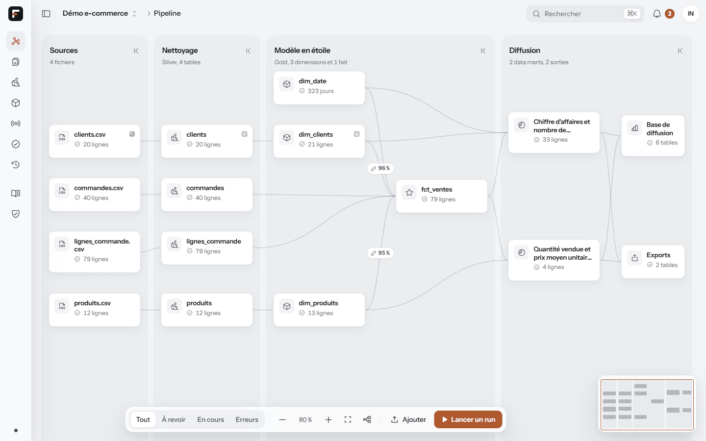
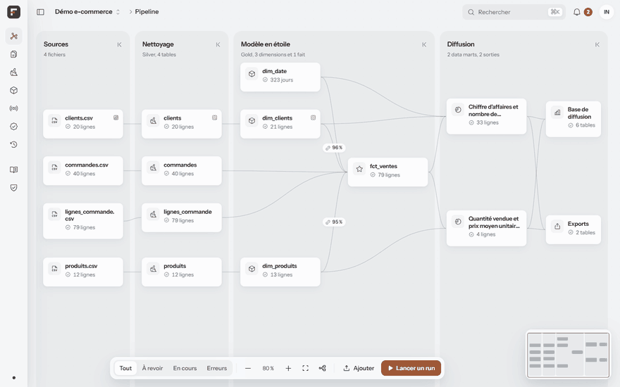

# Forja

[](https://github.com/forjadata/forja/actions/workflows/ci.yml)
[](https://github.com/forjadata/forja/actions/workflows/codeql.yml)
[](LICENSE)

*Français : [README.fr.md](README.fr.md)*

**Forja turns raw files and tables into clean, documented, BI-ready data, then lets
business teams ask for the tables they need in plain language, with a preview they
check before anything is published.**

Open source and *local-first*: everything runs on your machine, with or without an AI
model. A language model, when you add one, never sees your data values and never
writes SQL.

> **The interface is in French in v0.1** (and so are the questions to the agent).
> English is the first item of the next version. Code, docs and issues are in English.



## What Forja does

- **Ingests** CSV, Excel, Parquet and JSON files (up to 10 GB, resumable upload,
  streamed by DuckDB), PostgreSQL, MySQL/MariaDB and SQL Server tables (full or
  incremental) and paginated REST APIs. Every load is a version; schema drift is
  detected. **Scheduled** loads ("every day at 6 am") refresh everything down to the
  published data marts.
- **Profiles** every column: types (French and English dates and decimals), missing
  values, keys, duplicates, personal data (email, phone, IBAN, names) and a quality
  score.
- **Cleans** with a Silver plan reviewed rule by rule (each rule explained, values
  before and after), run by [dbt](https://www.getdbt.com/) on DuckDB; invalid rows go to
  quarantine, nothing disappears silently.
- **Models** a star schema (dimensions, SCD2, facts with an explicit grain), proposed by
  an AI model or by deterministic rules, validated, then built by dbt.
- **Serves** Power BI, Superset or Metabase through a DuckDB serving database, or Parquet
  and CSV exports, with personal data pseudonymized.
- **Answers questions**: an analyst asks for a data mart ("revenue per month and city in
  2024, business customers"). Forja shows what it understood, a sample, the SQL and
  reconciliation checks; the analyst corrects a term or validates, an engineer
  approves, Forja publishes.



Engineers get the pipeline canvas, plans, runs and governance; analysts a home page,
the agent, their data marts and the catalog of indicators. Notifications arrive live;
the interface has light and dark themes.

## Install in one command

You need [Docker](https://docs.docker.com/get-docker/) with Compose v2 and about 4 GB
of free disk. The images exist for linux/amd64 and linux/arm64.

```sh
git clone https://github.com/forjadata/forja.git && cd forja
./install.sh --demo            # macOS, Linux
.\install.ps1 -Demo            # Windows (PowerShell)
```

The script checks Docker and the free disk, pulls the two signed images (API and web)
from GitHub Container Registry, creates the administrator, loads the demo project with
`--demo`, starts everything and opens <http://localhost:3000>. **The administrator's and
the demo accounts' passwords are shown once**: note them; the first sign-in asks for a
new one. `--build` builds the images from the checkout instead.

```sh
docker compose up -d           # start again later
docker compose down            # stop (data stays in Docker volumes)
docker compose down -v         # stop and delete all data
```

Settings, upgrades, backups and troubleshooting: [getting started](docs/en/getting-started.md).
Without Docker: [CONTRIBUTING.md](CONTRIBUTING.md#development-setup) (uv and pnpm).

## AI provider: local, cloud or none

Forja works without an AI model: deterministic rules propose the star schema and a local
parser understands most questions. A model helps with ambiguous questions and unusual
schemas. Choose it in the settings screen, or in `.env`:

| Provider | Setting | Notes |
|---|---|---|
| None | `FORJA_LLM_PROVIDER=` | The default. Everything stays deterministic. |
| Ollama (local, free) | `FORJA_LLM_PROVIDER=ollama` | Your machine's Ollama (`qwen3.5:9b` by default); `./install.sh --ollama` runs it in a container instead (several GB). |
| Anthropic | `FORJA_LLM_PROVIDER=anthropic` and `ANTHROPIC_API_KEY` | |
| OpenAI | `FORJA_LLM_PROVIDER=openai`, `OPENAI_API_KEY` and `FORJA_LLM_MODEL` | |

## Privacy guarantees

They hold whatever the provider, and tests check them:

- **A model never receives a data value.** It sees schemas, statistics, relations and
  the semantic layer; never a row, a sample or a distinct value. Values typed by a user
  are resolved locally.
- **A model never writes SQL.** It returns a structured specification that Forja
  validates against the semantic layer; SQL comes from templates.
- **Personal data is pseudonymized outside Silver**: serving database, exports,
  previews and data marts use HMAC-SHA256 with a per-project salt kept outside the data
  folder. An analyst never sees it in clear.
- **Every action is audited** (who, what, when, on which object), roles are checked on
  every route, the session lives in httpOnly cookies and pages run under a strict
  Content-Security-Policy. Details: [security](docs/en/security.md); to report a
  vulnerability: [SECURITY.md](SECURITY.md).

## Key figures

Measured during the release test campaign ([benchmarks](docs/en/benchmarks.md)):

| | |
|---|---|
| One million rows, from file to exported data mart | about 33 s, peak memory about 1 GB |
| Five million rows, same journey | 73 s |
| 10 million rows from PostgreSQL, then 100,000 new rows | 55.8 s, then 3.5 s incremental |
| 2 GB upload cut twice, resumed | 12.8 s |
| Canvas shown after sign-in (Chrome) | 1.5 to 1.8 s; Lighthouse 98 |
| Agent questions answered without any model | 13 of 20 at once; ~200 tokens sent to a model otherwise, no value |

On a laptop CPU, a question that needs a local 9B model takes about two minutes; a GPU
or a cloud provider brings it to seconds.

## Architecture

```
 Browser ─► web (Next.js) ─proxy, httpOnly session─► API (FastAPI)
                ▲   Server-Sent Events (runs, notifications)    │
                └───────────────────────────────────────────────┤
                                                                ▼
 files, databases, APIs ─► Bronze (Parquet) ─► Silver ─► Gold (star) ─► serving, exports
              profiling        dbt + DuckDB, reviewed plans            │
                                                                       ▼
 semantic layer ◄── from Gold ──► agent: parser first, optional AI model
                                  (schemas only) ─► preview ─► dbt
```

One process holds the API and its job workers; DuckDB holds the metadata catalog and the
warehouse; dbt runs the transformations. More in [architecture](docs/en/architecture.md).

## Documentation

| | |
|---|---|
| [Getting started](docs/en/getting-started.md) | Install, settings, upgrade, backup |
| [Engineer guide](docs/en/guide-engineer.md) · [Analyst guide](docs/en/guide-analyst.md) | From a file to a published model; asking for a data mart |
| [Connectors](docs/en/connectors.md) | Databases, APIs, scheduling, large volumes |
| [Architecture](docs/en/architecture.md) · [Security](docs/en/security.md) | How it is built; accounts, roles, sessions, CSP, pseudonymization |
| [Agent](docs/en/agent.md) · [Semantic layer](docs/en/semantic-layer.md) | How a question becomes a data mart |
| [BI](docs/en/bi.md) · [Benchmarks](docs/en/benchmarks.md) | Plugging a BI tool; volumes, times, memory |

In French: the same pages in [docs/](docs/), plus the design decisions
([decisions.md](docs/decisions.md)), profiling rules, development notes and the
[report of the release test campaign](docs/campaign-report.md).

## Project status

**v0.1.0**, the first public release. One instance: one API process, its scheduler, its
in-memory event bus and a DuckDB catalog. It is tested end to end (Python, browser,
install from scratch, real databases, a real model) but young: expect rough edges, and
please report them.

## Roadmap

- **English interface** and English questions to the agent (next version).
- Sign-in through an identity provider (OIDC; the interface is ready).
- More sources: object storage (S3-compatible), more databases.
- Several API instances (shared event bus, scheduler and throttling).
- Published Python packages (`forjadata` on PyPI).
- The full agent evaluation on a cloud model; native Windows ARM64 Python once its
  dependencies ship wheels.

Ideas and votes are welcome in the issues.

## Contributing

Bug reports, questions and pull requests are welcome: see
[CONTRIBUTING.md](CONTRIBUTING.md) and the [Code of Conduct](CODE_OF_CONDUCT.md).
Changes are listed in the [CHANGELOG](CHANGELOG.md).

## License

[Apache 2.0](LICENSE). Third-party components and fonts: [NOTICE](NOTICE) and
[THIRD_PARTY_LICENSES.md](THIRD_PARTY_LICENSES.md). The name choices are explained in
[docs/naming.md](docs/naming.md).
