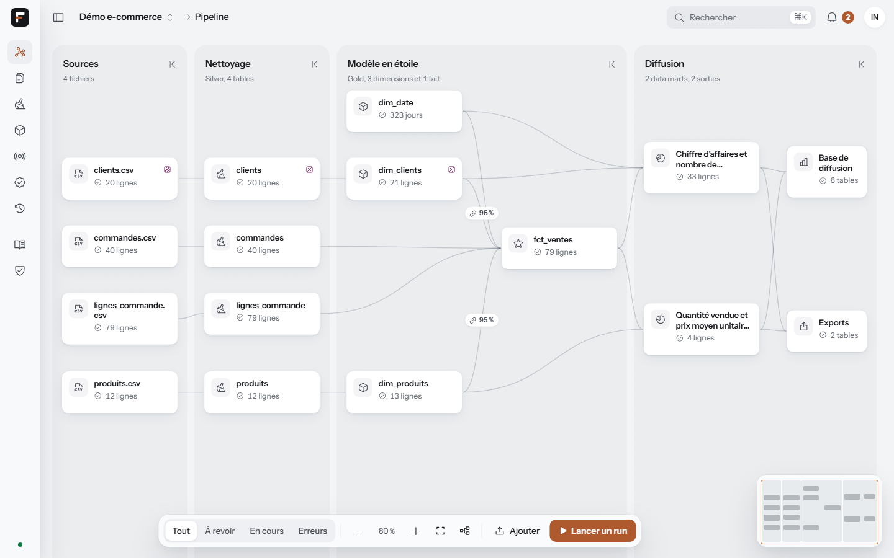

# Forja

[](https://github.com/koutamMoulaye/Forja/actions/workflows/ci.yml)
[](LICENSE)

**Forja transforme des fichiers bruts en données propres, documentées et prêtes pour la
BI, puis laisse les équipes métier demander en français les tables dont elles ont
besoin, avec un aperçu qu'elles vérifient avant toute publication.**

Open source et *local-first* : tout tourne sur votre machine, avec ou sans modèle d'IA.



## Ce que fait Forja

- **Ingestion** de fichiers CSV, Excel, Parquet et JSON (jusqu'à 10 Go, envoi
  reprenable, lecture en flux par DuckDB), de tables PostgreSQL, MySQL/MariaDB et SQL
  Server (complètes ou incrémentales) et d'API REST paginées ; chaque chargement est une
  version, avec détection de la dérive de schéma. Chargements **planifiés** (« tous les
  jours à 6 h ») jusqu'aux data marts publiés.
- **Profilage** de chaque colonne : types (dates et décimales à la française compris),
  valeurs manquantes, clés, doublons, données personnelles (email, téléphone, IBAN,
  noms) et score qualité.
- **Nettoyage** par un plan Silver relu règle par règle (chaque règle expliquée, valeurs
  avant et après), exécuté par [dbt](https://www.getdbt.com/) ; les lignes invalides
  vont en quarantaine, rien ne disparaît en silence.
- **Modélisation** en étoile (dimensions, SCD2, faits au grain explicite), proposée par
  un modèle d'IA ou par des règles déterministes, validée puis construite par dbt.
- **Diffusion** vers Power BI, Superset ou Metabase par une base DuckDB de diffusion, ou
  en exports Parquet et CSV, données personnelles pseudonymisées.
- **Questions en français** : un analyst demande un data mart (« CA par mois et par
  ville en 2024, clients Pro »). Forja montre ce qu'il a compris, un échantillon, le SQL
  et des contrôles de réconciliation ; l'analyst corrige un terme ou valide, un engineer
  approuve, Forja publie.

Les engineers ont le canvas du pipeline, les plans, les runs et la gouvernance ; les
analysts un accueil, l'agent, leurs data marts et le catalogue des indicateurs. Les
notifications arrivent en direct ; l'interface existe en thème clair et sombre.

## Installation en une commande

Il faut [Docker](https://docs.docker.com/get-docker/) avec Compose v2 et environ 4 Go
d'espace libre.

```sh
git clone https://github.com/koutamMoulaye/Forja.git && cd Forja
./install.sh --demo            # macOS, Linux
.\install.ps1 -Demo            # Windows (PowerShell)
```

Le script vérifie Docker et l'espace disque, construit les deux images (API et web),
crée l'administrateur, charge le projet de démo avec `--demo`, démarre le tout et ouvre
<http://localhost:3000>. **Le mot de passe de l'administrateur et ceux des comptes de
démo ne s'affichent qu'une fois** : notez-les ; la première connexion demande d'en
choisir un nouveau.

```sh
docker compose up -d           # redémarrer plus tard
docker compose down            # arrêter (les données restent dans les volumes Docker)
docker compose down -v         # arrêter et supprimer toutes les données
```

Les réglages vont dans un fichier `.env` à côté de `docker-compose.yml` (voir
[`.env.example`](.env.example)) : port, mode multi-utilisateur, fournisseur d'IA. Sans
Docker : [docs/development.md](docs/development.md) (uv et pnpm).

## Fournisseur d'IA : local, cloud ou aucun

Forja fonctionne sans modèle d'IA : des règles déterministes proposent le modèle en
étoile et un analyseur local comprend la plupart des questions. Un modèle aide pour les
questions ambiguës et les schémas inhabituels. Il se choisit dans **Réglages ›
Fournisseur IA**, ou dans `.env` :

| Fournisseur | Réglage | Remarques |
|---|---|---|
| Aucun | `FORJA_LLM_PROVIDER=` | Par défaut. Tout reste déterministe. |
| Ollama (local, gratuit) | `FORJA_LLM_PROVIDER=ollama` | Utilise l'Ollama de votre machine (`qwen3.5:9b` par défaut). `./install.sh --ollama` le lance plutôt dans un conteneur (plusieurs Go). |
| Anthropic | `FORJA_LLM_PROVIDER=anthropic` et `ANTHROPIC_API_KEY` | |
| OpenAI | `FORJA_LLM_PROVIDER=openai`, `OPENAI_API_KEY` et `FORJA_LLM_MODEL` | |

## Garanties de confidentialité

Elles valent quel que soit le fournisseur, et des tests les vérifient :

- **Un modèle ne reçoit jamais de valeur de données.** Il voit les schémas, des
  statistiques, les relations et la couche sémantique ; jamais une ligne, un échantillon
  ou une valeur distincte. Les valeurs tapées par un utilisateur sont résolues
  localement.
- **Un modèle n'écrit jamais de SQL.** Il renvoie une spécification structurée que Forja
  valide contre la couche sémantique ; le SQL est produit par des templates.
- **Les données personnelles sont pseudonymisées hors de Silver** : base de diffusion,
  exports, aperçus et data marts utilisent HMAC-SHA256 avec un sel par projet, rangé hors
  du dossier de données. Un analyst ne les voit jamais en clair.
- **Chaque action est journalisée** (qui, quoi, quand, sur quel objet), les rôles sont
  vérifiés sur chaque route, la session tient dans des cookies httpOnly et les pages
  s'exécutent sous une Content-Security-Policy stricte. Détails dans
  [docs/security.md](docs/security.md).

## Architecture

```
 Navigateur ─► web (Next.js) ─proxy, session httpOnly─► API (FastAPI)
                    ▲   Server-Sent Events (runs, notifications)  │
                    └─────────────────────────────────────────────┤
                                                                  ▼
  fichiers, bases, API ─► Bronze (Parquet) ─► Silver ─► Gold (étoile) ─► diffusion, exports
              profilage          dbt + DuckDB, plans relus           │
                                                                     ▼
  couche sémantique ◄── issue du Gold ──► agent : analyseur d'abord, modèle d'IA
                                          optionnel (schémas seuls) ─► aperçu ─► dbt
```

Un processus porte l'API et ses workers de jobs ; DuckDB tient le catalogue de
métadonnées et l'entrepôt ; dbt exécute les transformations. Plus de détails dans
[docs/architecture.md](docs/architecture.md).

## Documentation

| | |
|---|---|
| [Guide engineer](docs/guide-engineer.md) | D'un fichier à un modèle en étoile publié |
| [Connecteurs](docs/connectors.md) | Bases de données, API, planification, gros volumes |
| [Guide analyst](docs/guide-analyst.md) | Demander un data mart et le vérifier |
| [Architecture](docs/architecture.md) · [Décisions](docs/decisions.md) | Comment c'est construit, et pourquoi |
| [Sécurité](docs/security.md) | Comptes, rôles, sessions, CSP, pseudonymisation |
| [Agent](docs/agent.md) · [Couche sémantique](docs/semantic-layer.md) | Comment une question devient un data mart |
| [BI](docs/bi.md) · [Profilage](docs/profiling.md) | Brancher un outil BI ; règles de profilage |
| [Développement](docs/development.md) | Sans Docker, parcours par l'API, tests |

## État du projet

Version **0.1.0**. Une seule instance : un processus d'API, son planificateur, son bus
d'événements en mémoire et un catalogue DuckDB. Retours et tickets bienvenus.

## Licence

[Apache 2.0](LICENSE)
